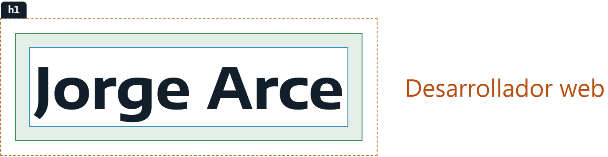
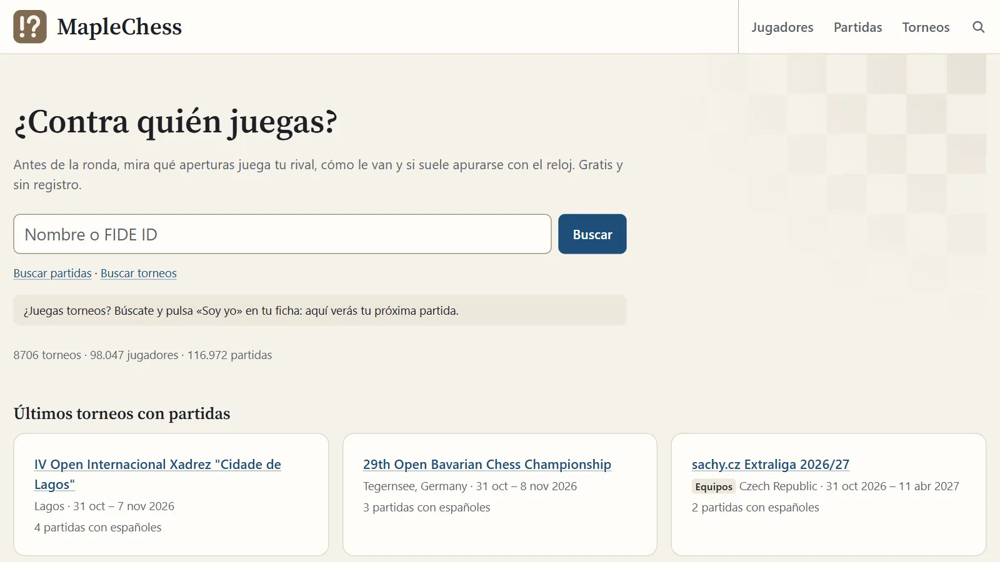
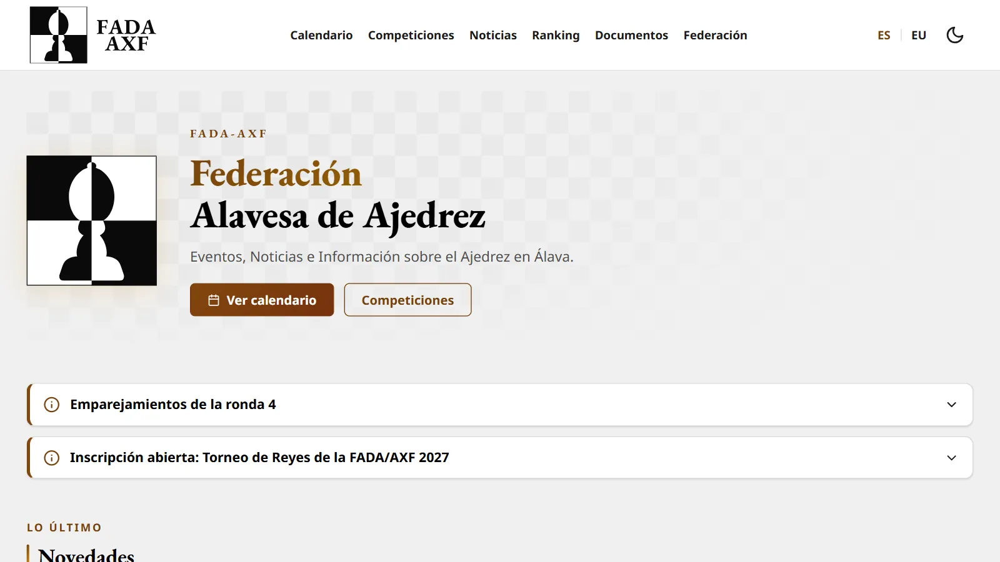
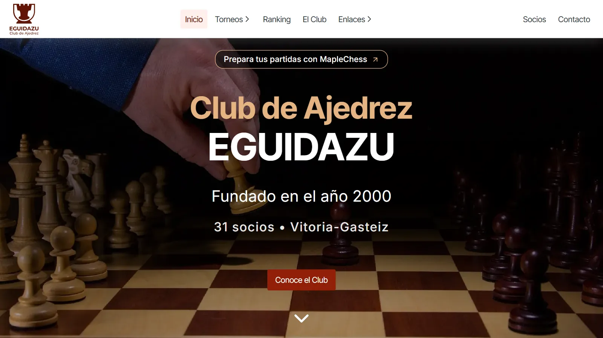
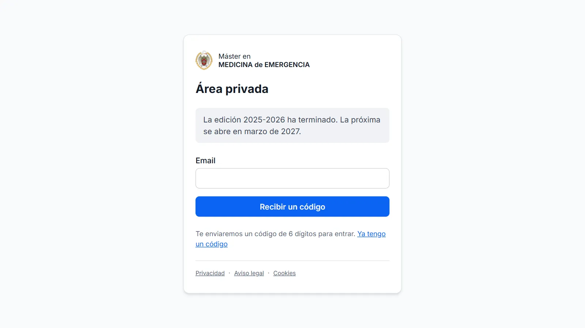

<!-- La cabecera sale de .github/readme/, en el tema claro y en el oscuro de GitHub, con rutas
     absolutas a main, la rama que enseña el perfil. Sin enlace alrededor: GitHub mete la imagen
     en el suyo, y con dos anidados el  se salía del <picture> -->
<h1>
  <picture>
    <source media="(prefers-color-scheme: dark)" srcset="https://raw.githubusercontent.com/jorgeabf/jorgeabf/main/.github/readme/cabecera-oscura.png">
    
  </picture>
</h1>

Hago webs con Astro desde 2022 y me fijo sobre todo en la **accesibilidad**, el **rendimiento** y el **SEO técnico**. También hago aplicaciones con base de datos en Cloudflare.

## Proyectos

<table>
  <tr>
    <td width="50%" valign="top">
      <a href="https://jorgearce.dev/portfolio/maplechess/"></a>
      <p><a href="https://jorgearce.dev/portfolio/maplechess/"><b>MapleChess</b></a><br>
      Para preparar partidas de ajedrez, con las aperturas de cada rival y un visor con Stockfish. Su <a href="https://github.com/jorgeabf/maplechess">código</a> es abierto.</p>
    </td>
    <td width="50%" valign="top">
      <a href="https://jorgearce.dev/portfolio/fada/"></a>
      <p><a href="https://jorgearce.dev/portfolio/fada/"><b>FADA (Federación Alavesa de Ajedrez)</b></a><br>
      La web de la federación, en castellano y euskera, con el calendario y el ranking de federados.</p>
    </td>
  </tr>
  <tr>
    <td width="50%" valign="top">
      <a href="https://jorgearce.dev/portfolio/eguidazu/"></a>
      <p><a href="https://jorgearce.dev/portfolio/eguidazu/"><b>Club de Ajedrez Eguidazu</b></a><br>
      La web del club, con sus torneos, el ranking FIDE de sus jugadores y un portal de socios.</p>
    </td>
    <td width="50%" valign="top">
      <a href="https://jorgearce.dev/portfolio/mme-area-privada/"></a>
      <p><a href="https://jorgearce.dev/portfolio/mme-area-privada/"><b>Área privada del Máster en Medicina de Emergencia</b></a><br>
      La plataforma del alumnado y el profesorado, con los cursos, las clases grabadas y las prácticas.</p>
    </td>
  </tr>
</table>

Y además, las webs del [Máster en Medicina de Emergencia](https://masteremergencias.com) y del [Máster GESPA](https://mastergespa.com), las [aulas del Máster GESPA](https://2026-2027.mastergespa.com) y la de la [Autoescuela San Prudencio](https://www.autoescuelasanprudencio.com). Qué hace cada uno y cómo está hecho, en [jorgearce.dev](https://jorgearce.dev/#proyectos).

## Con qué trabajo

- **Webs:** `Astro` `TypeScript` `CSS` sin frameworks, salvo `Tailwind` y `React` en las de GESPA
- **Servidor:** `Cloudflare Workers` `D1` `R2` `Workflows`
- **Alojamiento:** `Vercel` `Netlify` `Hostinger` `Nominalia`
- **Pruebas:** `Vitest` `axe-core`

## Contacto

Escríbeme a [hola@jorgearce.dev](mailto:hola@jorgearce.dev) o búscame en [LinkedIn](https://linkedin.com/in/jorge-arce-balluerca).

## Este repositorio

Es el código de [jorgearce.dev](https://jorgearce.dev): Astro estático en Vercel, sin JavaScript, cookies ni analítica. Para arrancarlo, con Node 24 y pnpm:

```bash
pnpm install
pnpm dev
```
